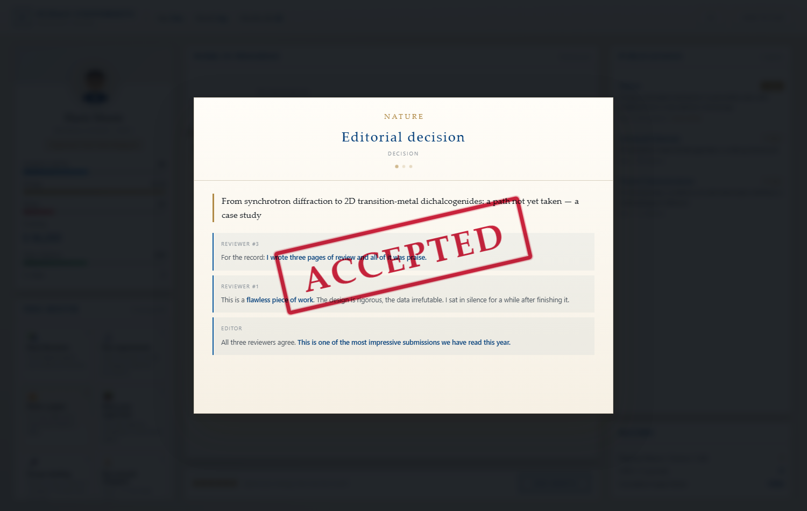
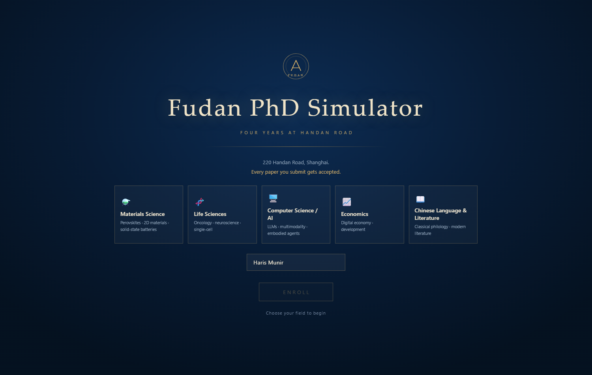

# Fudan PhD Simulator

**▶ Play: https://angie4448.github.io/fudan-phd/**

Four years at Handan Road, 48 months, five fields of study.
Pick a journal — *Nature*, *Science*, *Cell*, a CSSCI title — and every manuscript you
send out comes back **accepted**.



## How it plays

- **Six energy a month.** Read literature, run experiments, write, meet your supervisor,
  sit through group meeting, run around Jiangwan, or write a grant proposal.
- **Six data → one paper.** Turn your data into a manuscript, then choose a journal.
- **Everything is accepted.** No rejections, no major revisions, no “resubmit after
  revision”. The reviewers are, without exception, delighted.
- **Four years later** you walk into the defence. The ending depends on how much you
  published: from *PhD Conferred* to *The Road to the Academy*.

## Features

- Five fields with their own journals, topics and methods:
  Materials Science · Life Sciences · Computer Science & AI · Economics ·
  Chinese Language & Literature
- Paper titles, reviewer reports and campus news are generated
- Live stats: academic ability, stress, funding, citations, h-index
- A CV view and a publication record
- Synthesised sound — the acceptance stamp lands with a thud



## Tech

Plain HTML, CSS and JavaScript in a single file. No frameworks, no build step,
no network requests. Open it and play.

## Run locally

Double-click `index.html`, or:

```bash
python -m http.server 8000
# open http://localhost:8000
```

## Licence

MIT.
